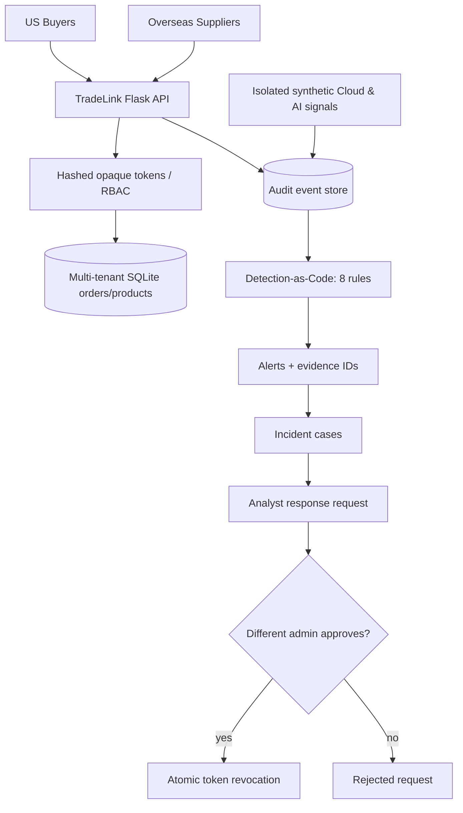

# TradeLink Enterprise Security Platform

**Cross-border B2B marketplace + integrated detection-as-code + incident case management.**

> **Portfolio transparency:** This is an independent educational security engineering lab. Marketplace HTTP requests, tenant enforcement, audit records, detection cases and analyst-approved session revocation run through real Python/Flask + SQLite application code. **Cloud IAM and AI agent signals are explicitly synthetic exercises**, not real AWS or AI agent integrations. This release is an **integrated MVP**, not an enterprise production deployment or full SIEM/SOAR product.

## System architecture



### Implemented capabilities

| Layer | Working implementation |
|---|---|
| Marketplace | Two tenants, suppliers and buyers, order/product API, parameterized SQL |
| Identity | PBKDF2-hashed passwords, 1h opaque session tokens hashed in storage, RBAC |
| Authorization | Server-side tenant-scoped reads and writes, 404 for foreign orders |
| Telemetry | Persistent searchable SQLite audit store, no plaintext tokens/passwords |
| Detection | 8 Python rules, persisted alerts, evidence event IDs, idempotent runs |
| Analyst workflow | Cases, dispositions, notes, response request and separate approval |
| Response | Approved revocation of target user's sessions; no automatic cloud changes |
| Demonstration | Real Flask test-client requests + clearly labeled synthetic cloud/AI signals |
| CI | Python 3.11 & 3.13 tests, compilation, dependency audit and static scan |
| Deployment | Local Python and loopback-only Docker Compose service |
| AWS | Optional Terraform S3 security example, **not deployed** |

This release does **not** include live AWS integration, native Elastic/Splunk rules, a production-grade web dashboard, real AI model/tool calls, nor continuously running cloud-scale ingestion.

## Start on a Mac (Python 3.13)

```bash
git clone https://github.com/ruigengzhang/tradelink-enterprise-security-platform.git
cd tradelink-enterprise-security-platform
python3.13 -m venv .venv
source .venv/bin/activate
python -m pip install -e ".[dev]"
tradelink-enterprise seed
tradelink-enterprise demo
pytest -q
```

Demo account password (only for this disposable lab): `TradeLink-Demo-Only!`.

- Buyer: `pacific-buyer`, `atlantic-buyer`
- Supplier: `pacific-supplier`, `atlantic-supplier`
- Analysts: `soc-analyst` and `security-admin`

`tradelink-enterprise demo` uses Flask's in-process test client and does **not** open a network port. It creates evidence in `instance/tradelink.sqlite3`. To reset the lab, remove the local `instance/` folder; this deletes only locally seeded demo data.

### Launch the local HTTP API

```bash
tradelink-enterprise serve --port 5000
```

Server listens on `127.0.0.1:5000` by default.

```bash
curl http://127.0.0.1:5000/health
curl -s http://127.0.0.1:5000/api/auth/login -H 'Content-Type: application/json' \
  -d '{"username":"soc-analyst","password":"TradeLink-Demo-Only!"}'
```

Use `Authorization: Bearer <access_token>` returned by login for protected routes. See the [analyst runbook](docs/analyst-runbook.md) for the full case workflow.

### Docker Compose (optional)

```bash
docker compose build
docker compose run --rm tradelink tradelink-enterprise --db /app/instance/tradelink.sqlite3 seed
docker compose up -d
curl http://127.0.0.1:5000/health
docker compose down
```

Compose binds only to localhost and stores test data in a named volume. Do not expose demo credentials or this lab to the internet. Python development server is not hardened for external deployment.

## Detection scenarios

- **A: Account takeover / suspicious marketplace activity.** Failed sign-ins followed by a successful login from an unfamiliar IP, rejected cross-tenant access, and a simulated large export. Application requests and authorization responses are actually executed through Flask.
- **B: Cloud permission drift.** A **synthetic** unauthorized cloud IAM policy modification record is inserted into audit storage; detection tests the log rule, not real AWS CloudTrail.
- **C: Agent tool abuse.** A **synthetic** blocked bank-account modification request is logged; detection recognizes a denied tool event, not a live AI-agent prompt-injection test.

Use `tradelink-enterprise detect` to rerun detection (no duplicate alerts for identical evidence).

## Evidence and documentation

- [Security architecture & threat model](docs/threat-model.md)
- [Detection catalog and limitations](docs/detections.md)
- [SOC analyst runbook](docs/analyst-runbook.md)
- [Sample incident report](docs/incident-report.md)
- [Security controls, risk register, roadmap](docs/security-controls.md)
- [Terraform AWS extension (not deployed)](infra/terraform/README.md)

## Portfolio demo / interview

Explain a denied foreign-tenant order access with 404, locate the related audit event, trigger TL-103, inspect its evidence IDs, set case disposition, request an approved response, and verify the supplier's session is revoked. Explicitly state which cloud/AI events are generated fixtures. See [demo script](docs/demo-script.md).

## Roadmap for a production-like flagship

1. Add actual event streaming to OpenSearch/Elastic or Sentinel, native SIEM rules, back-pressure and monitoring.
2. Deploy the service to an isolated AWS account (IaC, TLS, WAF, CloudTrail, GuardDuty), and ingest real audit logs.
3. Integrate an actual AI service identity and policy decisions from the separate TradeLink AI lab.
4. Add role-isolated analyst UI, durable queue, background detection, alert quality metrics and MTTD/MTTR.
5. Add comprehensive operational hardening, OAuth/OIDC, backups, secret rotation and threat-detection tuning.

## Safety and scope

All account names, orders, addresses and data are fictional. RFC 5737 example IP ranges are used for attack-like scenarios. The project is intended for locally owned test environments only. Do not use these examples against third-party services.

MIT License.
